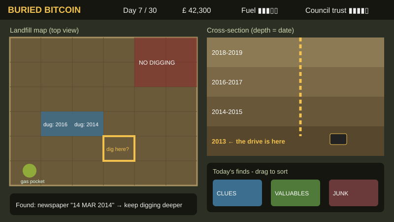

# ביטקוין קבור (Buried Bitcoin)

**8,000 ביטקוין, מזבלה אחת ו-30 יום לחפור.**

## על המשחק

ב-2013 ג'יימס האוולס מוויילס זרק בטעות כונן קשיח עם המפתח לכ-8,000 ביטקוין, והכונן נקבר במזבלה של העיר ניופורט. במשחק אתם מקבלים סוף סוף אישור לחפש אותו.

המזבלה ענקית, ויש לכם רק 30 ימי עבודה ותקציב מוגבל. הזבל נערם בשכבות לפי תאריכים, ולכן כל עיתון ישן או קרטון חלב שעולה מהאדמה הוא רמז שעוזר להבין כמה עמוק השכבה של 2013. בדרך צריך להיזהר מכיסי גז, מגשם שמציף את הבורות ומהעירייה, שיכולה לסגור את האתר בכל רגע.

מחט בערמת שחת - רק שהמחט שווה מיליארד דולר.

## מסמך עיצוב

[הרכיבים הרשמיים של המשחק וסקירת משחקים קיימים](formal-elements.md)

## חברי הצוות

* דוד בלוך ([davidbloch18](https://github.com/davidbloch18))
* עומרי סבג ([omrisabag2001](https://github.com/omrisabag2001))

